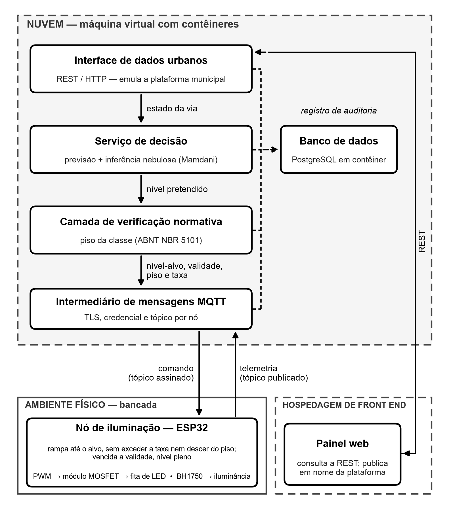
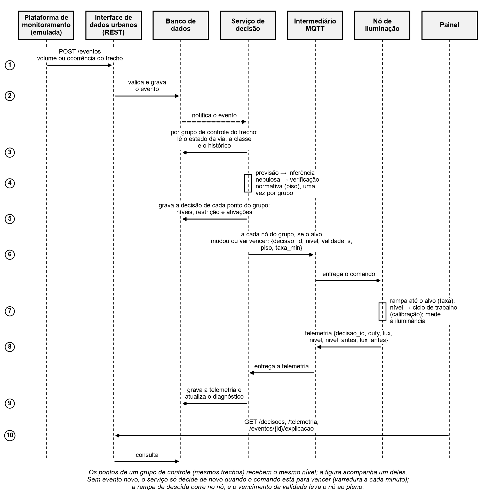
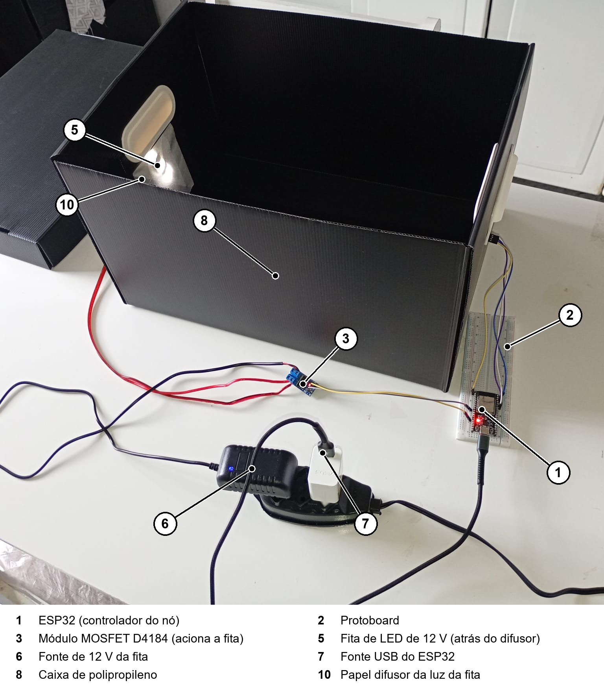
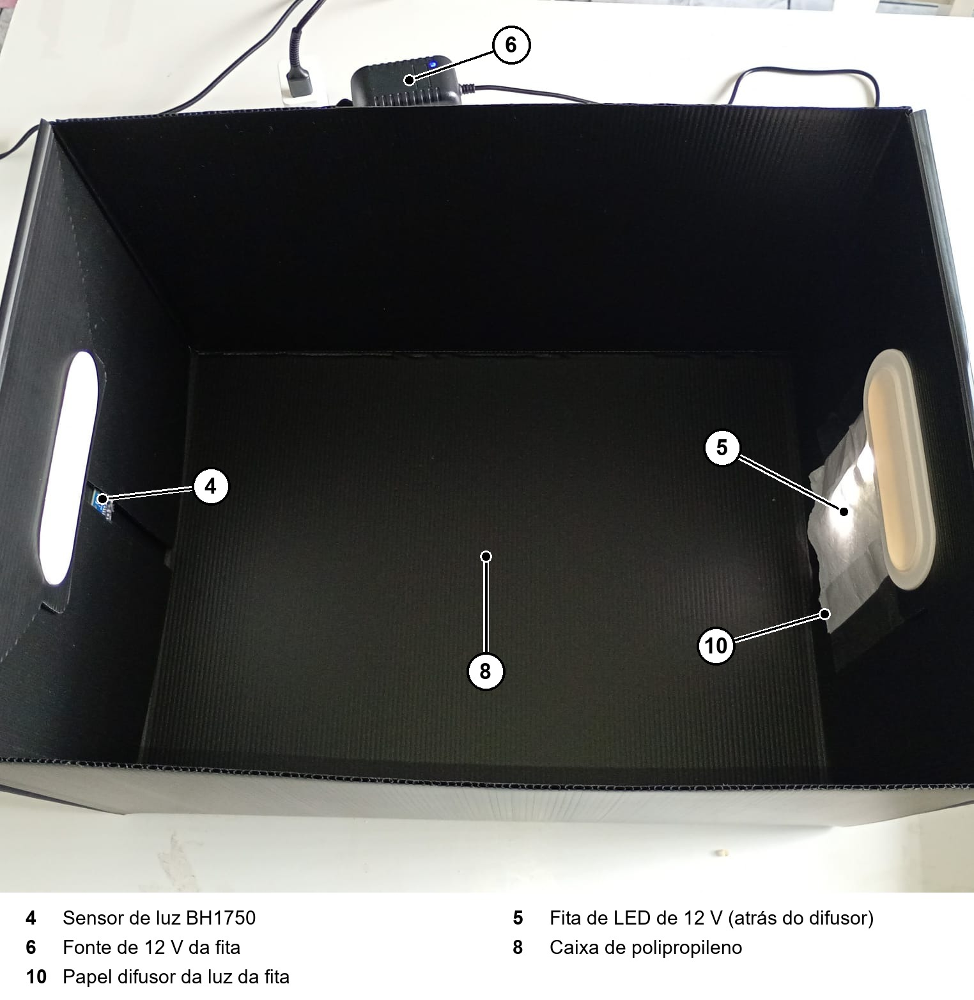
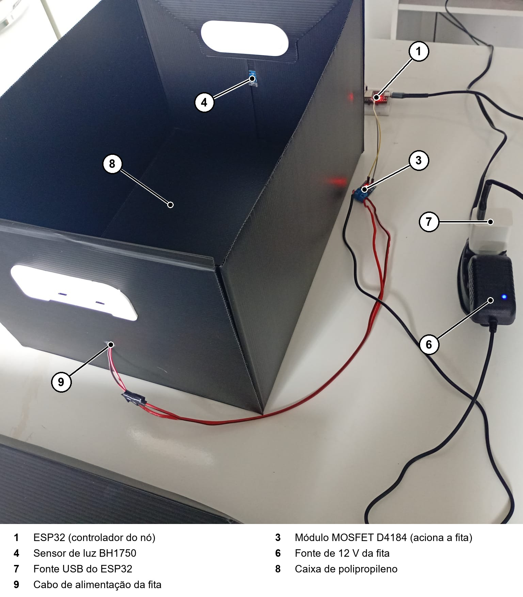
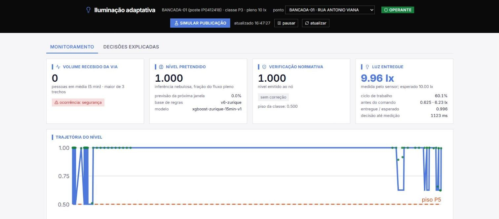
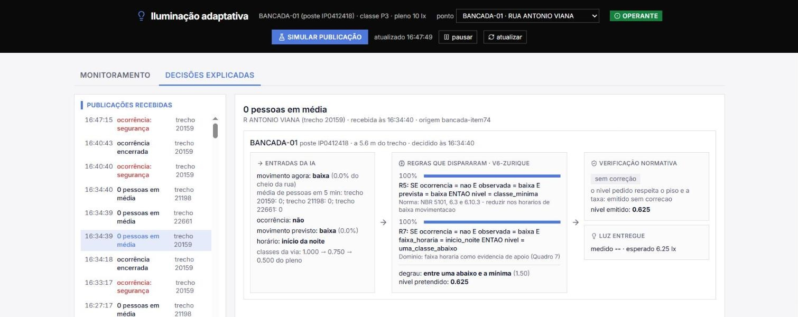
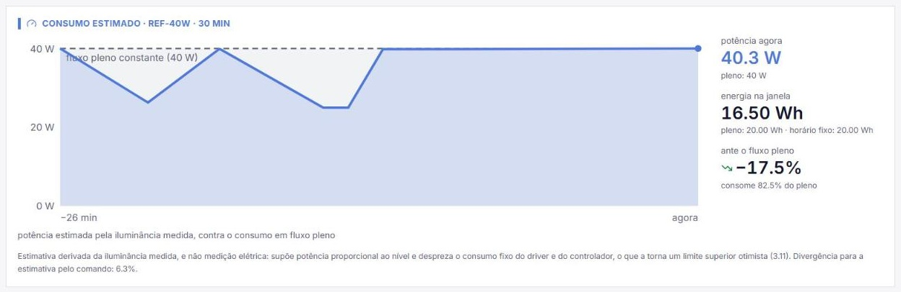
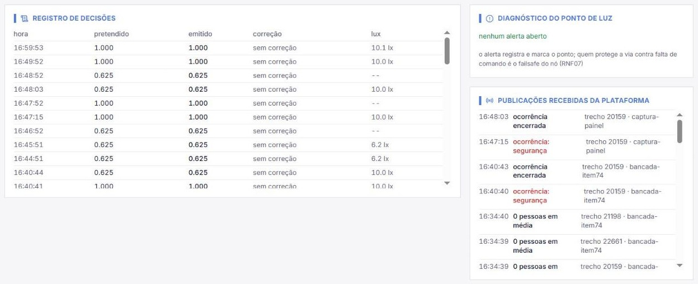

# Iluminação pública adaptativa para São Paulo

Trabalho de Conclusão de Curso (2026) de **Vitor Oliveira dos Santos**, **Lucas de Araujo Vergara** e **Bruno Bonavigo Dacal**.

O texto completo do TCC está em [`Transicao_pre-projeto-para-TCC-Completo_TCC_Iluminacao_SP_v70.docx`](Transicao_pre-projeto-para-TCC-Completo_TCC_Iluminacao_SP_v70.docx), a versão mais recente.

---

## Sumário

1. [O que é o projeto](#1-o-que-é-o-projeto)
2. [Como funciona](#2-como-funciona)
3. [Fotos do protótipo](#3-fotos-do-protótipo)
4. [Principais resultados](#4-principais-resultados)
5. [Dados usados](#5-dados-usados)
6. [Tecnologias](#6-tecnologias)
7. [O que tem em cada pasta](#7-o-que-tem-em-cada-pasta)
8. [Como o projeto foi desenvolvido (programação em par com IA)](#8-como-o-projeto-foi-desenvolvido-programação-em-par-com-ia)
9. [Como reproduzir os resultados](#9-como-reproduzir-os-resultados)
10. [Limites do trabalho](#10-limites-do-trabalho)

---

## 1. O que é o projeto

São Paulo já tem **câmeras que observam o uso das ruas** (plataforma de monitoramento urbano) e **luminárias LED cuja intensidade pode ser regulada à distância** (telegestão da concessão de iluminação). Hoje, porém, os dois sistemas não se comunicam.

Este projeto constrói a **camada que falta entre os dois**: um serviço em nuvem que recebe quantas pessoas há em cada trecho de rua e decide quanta luz cada poste deve dar. A decisão sempre respeita o mínimo exigido pela norma brasileira de iluminação pública, a **ABNT NBR 5101**.

Na prática, o sistema funciona assim:
- rua com movimento ou ocorrência registrada → **luz plena** (classe P3, 10 lux);
- rua vazia de madrugada → a luz **desce devagar** até o mínimo permitido (classe P5, 5 lux);
- se o poste perde contato com o servidor → ele **volta sozinho para a luz plena**, por segurança.

O protótipo foi demonstrado em um **nó físico de bancada**: um ESP32 que controla uma fita de LED e mede a luz com um sensor. Ele usa dados reais de cadastro do bairro **Jardim Helena**, em São Paulo.

> **Em uma frase:** o projeto mostra que dados que o município já produz podem comandar a luz das ruas com segurança normativa garantida por construção.

---

## 2. Como funciona



O caminho de uma decisão:

1. **A plataforma publica um evento.** É o volume de pessoas no trecho, em média de 5 min, ou uma ocorrência (segurança ou trânsito). A publicação chega por uma API REST.
2. **A previsão estima o movimento da próxima hora.** O modelo é um XGBoost treinado com contagens reais de pedestres.
3. **As regras decidem o nível de luz.** São 7 regras de inferência nebulosa (Mamdani), escritas em linguagem simples, por exemplo: *"rua vazia e previsão de rua vazia → classe mínima"*.
4. **A camada de verificação normativa corrige a decisão, se preciso.** Ela nunca deixa o nível ficar abaixo do piso da norma. Essa camada está **sempre** no caminho: nenhuma decisão chega ao poste sem passar por ela.
5. **O comando segue para o poste** por MQTT, com TLS e credencial por dispositivo.
6. **O poste aplica a luz.** Ele desce no máximo 10 % do pleno por minuto (regra da norma) e devolve a luz medida (telemetria).
7. **Tudo fica gravado no banco** e aparece no painel, com a explicação regra a regra.

Postes que enxergam os mesmos trechos de rua formam um **grupo de controle** e recebem a mesma decisão, calculada uma vez só. É isso que permite pensar em escala de cidade, com mais de 600 mil pontos de luz.



---

## 3. Fotos do protótipo

### Nó de bancada (montado pelos autores)

| Visão geral | Por dentro do anteparo | Vista de trás |
|---|---|---|
|  |  |  |

O nó tem:
- um ESP32;
- um sensor de luz BH1750;
- um módulo MOSFET;
- uma fita de LED de 12 V.

Tudo fica dentro de uma caixa fechada, com a luz numa ponta e o sensor na outra, para que a luz ambiente não interfira na medição.

### Painel de acompanhamento

| Monitoramento | Decisão explicada |
|---|---|
|  |  |

| Consumo estimado | Registro de decisões |
|---|---|
|  |  |

Estas capturas do painel foram feitas na sessão de bancada de 10/10/2026, com dados da VM. No texto do TCC, as Figuras 6 a 10 são capturas mais recentes, que mostram **postes simulados** com volumes de demonstração; por isso elas **não são resultado**, apenas ilustram o painel.

---

## 4. Principais resultados

Todos os números abaixo estão no Capítulo 4 do TCC. A seção 9 mostra como obter cada um.

### Segurança normativa

| O que foi medido | Resultado |
|---|---|
| Passos de 5 s verificados (suíte de cenários + avaliação dos componentes de IA) | **667.200** |
| Violações do piso da norma ou da taxa de descida | **zero** |

### Bancada (nó físico, 10/10/2026)

| O que foi medido | Resultado |
|---|---|
| Latência do evento até a luz medida no nó, em 30 repetições | **1,03 s a 1,47 s** (mediana 1,25 s) |
| Falha induzida (fita desligada) | detectada pelo diagnóstico |
| Poste sem comando | voltou sozinho ao pleno quando a validade venceu (failsafe) |
| Conexão sem credencial | recusada pelo broker |
| Casos de teste CT15 a CT20 | todos satisfeitos |
| Testes automatizados | 281 aprovados (284 hoje, com 3 do modo de teste, fora do TCC) |

### Energia e luz adequada

A energia é **estimada** numa luminária de referência de 40 W (e de 440 W), sem medição elétrica.

| Regime | Energia (suíte) | Tempo com o nível esperado |
|---|---|---|
| Luz plena a noite toda | 746,7 Wh (base) | 58,0 % |
| Horário fixo (reduz das 0 h às 5 h) | 530,0 Wh | 72,2 % |
| **Adaptativo (este projeto)** | **565,3 Wh** | **98,2 %** |

- Ante a luz plena, a economia foi de **24,3 %** na suíte de cenários e de **37,6 %** em noites reais de Zurique.
- Ante o horário fixo, o sistema gastou **6,7 % a mais** na suíte e **21,4 % a menos** nas noites reais, mas acertou o nível esperado em 98,2 % do tempo, contra 72,2 %.

### Previsão (Zurique, dados de 15 min)

| Modelo | Erro médio (MAE) | Acerto da faixa |
|---|---|---|
| **XGBoost** | **0,0416** | **91,4 %** |
| Random Forest | 0,0429 | 91,2 % |
| Regressão linear | 0,0633 | 87,4 % |
| Média sazonal | 0,0688 | 84,3 % |
| Persistência | 0,0763 | 82,8 % |

Com a regra de 2 % fixada antes do experimento, o XGBoost superou a Random Forest em 3,0 % (melhor em 11 de 12 pontos de contagem).

### Hipóteses

| Hipótese | Resultado |
|---|---|
| H1: o sistema ajusta a luz conforme a situação | **aceita**, com ressalva |
| H2: a camada de verificação impede qualquer violação da norma | **aceita** |
| H3: antecipar pela previsão reduz o tempo em transição | **rejeitada** (a antecipação aumentou esse tempo) |

### O que aprendemos sobre a IA (achados honestos)

- A **previsão** só se destacou das alternativas simples com dados de 15 min. Com dados por hora (Melbourne), a média sazonal empatou com ela.
- A **inferência nebulosa** foi igualada por uma tabela simples de regras em degraus. O valor do sistema está **nas regras e na verificação**, não na matemática nebulosa.

---

## 5. Dados usados

| Dado | Origem | Para quê | No repositório? |
|---|---|---|---|
| Contagem de pedestres de **Zurique**, a cada 15 min | Portal de dados abertos de Zurique (licença CC0), baixada em 30/09/2026 | Treino e avaliação da previsão (série principal) | Não (60 MB). Baixar pelo comando da seção 9 |
| Contagem de pedestres de **Melbourne**, por hora | Portal de dados abertos de Melbourne, extraída em 23/09/2026 | Primeira versão da previsão e tercis | Não. Baixar por `modelo/baixar_dados.py` |
| Cadastro de **trechos de rua e postes** do Jardim Helena | GeoSampa (Prefeitura de São Paulo) | Ligar cada poste aos trechos que ele ilumina (até 25 m) | Sim, em `Codigo/cadastro/dados` e `Codigo/db/seed_cadastro.sql` |
| Classes de iluminação P3 a P6 | ABNT NBR 5101:2024 | Piso e taxa da camada de verificação | Sim, em `Codigo/db/seed.sql` |
| Medições de bancada | Nó físico dos autores, sessões de 10/10/2026 | Latência, failsafe, diagnóstico e energia de bancada | Sim, em `Codigo/bancada/resultados` |

**Nenhum dado pessoal** é usado ou guardado: não há imagem, áudio nem identificação de pessoas, só contagens por trecho (RNF08).

Os volumes do bairro mostrados no mapa do painel são **inventados** por um gerador de demonstração e **nunca** entram nos resultados.

---

## 6. Tecnologias

| Parte | Tecnologia |
|---|---|
| API de eventos (entrada dos dados urbanos) | Python 3.12 + FastAPI |
| Previsão | XGBoost (Chen e Guestrin, 2016) |
| Regras de decisão | scikit-fuzzy (inferência Mamdani) |
| Verificação normativa | módulo próprio em Python, que lê os limites do banco |
| Mensageria | MQTT com TLS (Mosquitto) |
| Banco de dados | PostgreSQL 16 |
| Painel | Vite + React + Tailwind 4 + Leaflet (mapa) |
| Firmware do nó | C++/Arduino no ESP32 |
| Implantação | Docker Compose numa VM da Oracle Cloud (camada gratuita), com Caddy |
| Testes | pytest |

---

## 7. O que tem em cada pasta

```
TCC2/
├── README.md                     ← este arquivo
├── Transicao_..._v70.docx        ← texto do TCC (versão mais recente; v68 e v69 ficam como histórico)
├── REVISAR_ANTES_DE_SUBMETER.txt ← lista de tudo que a IA propôs e os autores conferiram
├── FOLHA_DE_DEFESA.md, VALIDACAO_*.md, AUDITORIA_*.md ← conferências do texto e das fontes
├── ferramentas_docx/             ← scripts que editam o .docx de forma rastreável (uma rodada por versão)
├── Docs/
│   ├── Fotos/                    ← fotos do nó e capturas do painel
│   ├── Figuras/                  ← diagramas do README (gerados por Codigo/figuras)
│   ├── Entregavel2/              ← Guia do Usuário e Manual de Operação
│   ├── Pre-projeto/              ← pré-projeto
│   └── TCC-Desenvolvimento/      ← versões do texto ao longo do semestre
└── Codigo/
    ├── api_eventos/   ← API REST: recebe volumes e ocorrências e expõe decisões, telemetria e explicações
    ├── decisao/       ← o coração: previsão, regras (inferência), verificação, rampa, grupos, diagnóstico, energia
    │   └── regras/    ← bases de regras versionadas (.toml); a vigente é a v4-volume
    ├── modelo/        ← download dos dados, treino do XGBoost, protocolos e resultados (resultados/*.json)
    ├── cenarios/      ← suíte de cenários (suite/*.json), executor e avaliação dos componentes de IA
    ├── bancada/       ← calibração, conferência e sessões de teste do nó físico (resultados/)
    ├── firmware/no/   ← código do ESP32 (no.ino) e tabela de calibração
    ├── simulador/     ← nó simulado, frota do bairro e gerador de volumes de demonstração
    ├── cadastro/      ← recorte do GeoSampa e associação poste ↔ trecho
    ├── db/            ← schema.sql, cargas iniciais (seed) e migrações
    ├── broker/        ← configuração do Mosquitto local
    ├── painel/        ← painel web (React)
    ├── deploy/        ← roteiro e arquivos da implantação na VM
    ├── figuras/       ← scripts que desenham os diagramas do TCC
    ├── custo/         ← estimativa de custo da arquitetura em escala (Apêndice D)
    ├── tests/         ← testes automatizados
    ├── DIVERGENCIAS_TCC.txt ← diário das decisões técnicas, numeradas
    └── docker-compose.yml   ← banco e broker para rodar localmente
```

---

## 8. Como o projeto foi desenvolvido (programação em par com IA)

O desenvolvimento foi **iterativo e incremental**: a cada rodada, uma parte da especificação virava código, era testada e voltava para o texto. O histórico do git registra a ordem real das atividades.

Divisão por área de responsabilidade:
- **Vitor:** nó, firmware, comunicação segura, nuvem e banco.
- **Lucas:** módulo de inteligência (previsão, regras, métricas).
- **Bruno:** requisitos, normas, dados urbanos e operação (painel e alertas).

**Uso de IA generativa.** Entre 13/09/2026 e 10/11/2026, o trabalho usou o **Claude Opus 5 e Claude Opus 5.5 (Anthropic), pela ferramenta Claude Code**, em **programação em par** com papéis fixos:
- **A IA foi a executora:** escreveu código, scripts, protocolos e versões de texto.
- **Os autores foram os navegadores:**
  - definiram o problema, os requisitos e a arquitetura;
  - aprovaram cada critério **antes** de rodar cada experimento;
  - conferiram cada saída contra o protótipo, os dados e as fontes;
  - rejeitaram ou corrigiram o que não se sustentava.

Algumas práticas garantiram que o trabalho continuasse dos autores:
- **Protocolo antes do resultado.** Cada experimento tem um `PROTOCOLO_*.md` escrito e versionado **antes** de rodar. O hash do commit do protocolo e o do resultado estão no Apêndice B do TCC.
- **Lista de revisão.** Tudo que a IA propôs como critério, interpretação, conclusão ou fonte entrou em [`REVISAR_ANTES_DE_SUBMETER.txt`](REVISAR_ANTES_DE_SUBMETER.txt), e só os autores marcam como conferido.
- **Fontes conferidas no navegador.** As referências foram abertas e conferidas uma a uma (`VALIDACAO_REFERENCIAS_*.md`).
- **Resultado ruim também é publicado.** H3 rejeitada, previsão substituível com dados por hora e Mamdani igualado por tabela estão declarados no texto.
- **Declaração completa.** O Apêndice A do TCC (Quadro 19) diz, seção por seção, o que a IA gerou e quanto os autores conferiram ou refizeram.

---

## 9. Como reproduzir os resultados

Os comandos abaixo correspondem ao **Quadro 20 (Apêndice B)** do TCC, que lista o programa, os dados, o comando e o commit de cada resultado.

### 9.1 Preparar o ambiente (uma vez)

Você precisa de:
- **Python 3.12**;
- **Docker Desktop**;
- **Git**;
- **Node.js**, só se quiser rodar o painel.

```bash
git clone https://github.com/oliveiravitor32/TCC2.git
cd TCC2/Codigo
python -m venv .venv
```

Ative o ambiente:

```bash
source .venv/Scripts/activate
```

No Linux ou no macOS, o caminho é outro:

```bash
source .venv/bin/activate
```

Instale as dependências (o `matplotlib` só é usado para desenhar as figuras):

```bash
pip install -r requirements-dev.txt matplotlib
```

**Todos os comandos a seguir rodam dentro da pasta `Codigo`, com o ambiente ativado.**

### 9.2 Baixar os dados

**Zurique (série principal, cerca de 60 MB):**

```bash
curl -L -o modelo/dados/zurique_pedestres_15min.parquet "https://data.stadt-zuerich.ch/dataset/ted_taz_verkehrszaehlungen_werte_fussgaenger_velo/download/verkehrszaehlungen_werte_fussgaenger_velo_alle_jahre.parquet"
```

O portal de Zurique **atualiza esse arquivo**. A cópia usada no TCC tem o resumo SHA-256 `34a41dceb3a145fae5ae2b52d63bc91f540c761161e231dbf1d95bd60f04c42d`, registrado em `modelo/dados/zurique_extracao.json`. Confira o seu arquivo com:

```bash
sha256sum modelo/dados/zurique_pedestres_15min.parquet
```

Se o resumo for diferente, o arquivo é mais novo, e os números podem mudar um pouco.

**Melbourne (série anterior, por hora):**

```bash
python -m modelo.baixar_dados
```

A mesma observação vale aqui: o portal de Melbourne também cresce com o tempo, e a extração do TCC é de 23/09/2026 (`modelo/dados/extracao.json`).

### 9.3 Previsão (TCC 4.1, 3.6 e Tabela 4)

Os comandos abaixo **não precisam do banco**.

| Resultado | Comando | Onde sai |
|---|---|---|
| Erro do XGBoost × Random Forest × linear × referências (Zurique) | `python -m modelo.treinar_zurique` | `modelo/resultados/metricas_zurique.json` |
| Comparação de modelos em Melbourne | `python -m modelo.comparar_modelos` | `modelo/resultados/comparacao_modelos.json` |
| Sensibilidade da régua ao percentil (p99) | `python -m modelo.sensibilidade_percentil` | `modelo/resultados/sensibilidade_percentil.json` |
| Tabela 4: 15 min × 1 h | `python -m modelo.experimento_zurique` e depois `python -m modelo.conferencia_zurique` | `modelo/resultados/` |

Na saída do primeiro comando, confira a linha:

```
  xgboost         MAE 0.0416 noite 0.0228 faixa 0.914 F1 0.638
```

Esse comando foi reexecutado em 11/11/2026, e o resultado foi idêntico ao do texto.

### 9.4 Suíte de cenários e avaliação da IA (TCC 4.2, 4.4, 4.5, 4.6 e Tabela 3)

Esta parte **precisa do banco**. Suba o banco e o broker com o comando abaixo. Na primeira vez, ele cria as tabelas e carrega as classes da norma e o cadastro do Jardim Helena.

```bash
docker compose up -d
```

**Suíte principal.** Roda o modo em operação, depois o modo sem previsão (H3), depois a tabela em degraus no lugar do Mamdani:

```bash
python -m cenarios.executar --serie
```

```bash
python -m cenarios.executar --serie --reativo
```

```bash
python -m cenarios.executar --serie --degraus
```

Aderência ao envelope dos três regimes (adaptativo, pleno e horário fixo):

```bash
python -m cenarios.aderencia_regimes
```

**Noites reais e falha de contagem (Tabela 3).** Rode as duas execuções abaixo, nos modos descritos no protocolo, e depois a análise:

```bash
python -m cenarios.executar --pasta avaliacao_ia/zurique --serie
```

```bash
python -m cenarios.executar --pasta avaliacao_ia/camera --serie
```

```bash
python -m cenarios.avaliacao_ia.analisar
```

Déficit de luz em relação ao nível pedido:

```bash
python -m cenarios.avaliacao_ia.deficit
```

**Substitutos simples (média sazonal no lugar do XGBoost; ruído nos tercis):**

```bash
python -m cenarios.executar --pasta avaliacao_ia/zurique --serie --previsao media-sazonal
```

```bash
python -m cenarios.executar --pasta avaliacao_ia/camera --serie --previsao media-sazonal
```

```bash
python -m cenarios.executar --pasta avaliacao_ia/ruido --serie
```

```bash
python -m cenarios.executar --pasta avaliacao_ia/ruido --serie --degraus
```

```bash
python -m cenarios.avaliacao_ia.analisar_substitutos
```

**Mudanças perceptíveis de nível (Mamdani × tabela × tabela com histerese):**

```bash
python -m cenarios.executar --pasta avaliacao_ia/suavidade --serie
```

```bash
python -m cenarios.executar --pasta avaliacao_ia/suavidade --serie --degraus
```

```bash
python -m cenarios.executar --pasta avaliacao_ia/suavidade --serie --degraus --histerese 0.05
```

```bash
python -m cenarios.avaliacao_ia.analisar_suavidade
```

Cada execução da suíte leva cerca de **30 s**. A suíte principal e a aderência foram reexecutadas em 11/11/2026 e bateram com o texto: 13.440 decisões, zero violações, 565,3 Wh e aderência de 98,2 % (adaptativo), 72,2 % (horário fixo) e 58,0 % (pleno). Os relatórios saem em `cenarios/resultados/`. Os modos exatos de cada experimento estão nos protocolos de `cenarios/avaliacao_ia/` (`PROTOCOLO.md`, `PROTOCOLO_SUBSTITUTOS.md` e `PROTOCOLO_SUAVIDADE.md`).

### 9.5 Testes automatizados (TCC 3.12.9, CT01 a CT14)

Com o banco ligado:

```bash
python -m pytest -q
```

Esperado: **284 passed**, que são os 281 do TCC mais 3 do modo de teste do painel. A execução leva uns 4 minutos e foi conferida em 11/11/2026. Sem o banco, só 147 testes são coletados, porque os que usam o banco ficam de fora.

### 9.6 Rodar o sistema completo localmente (com nó simulado)

O script abaixo sobe o banco, o broker, a API, o serviço de decisão, um nó simulado e o painel:

```bash
./subir.sh
```

Na primeira vez, para o painel funcionar, instale as dependências dele:

```bash
cd painel && npm install && cd ..
```

Publique um evento de teste, por exemplo uma média de 0,2 pessoa no trecho nos últimos 5 min (as outras opções estão no início do script):

```bash
./evento.sh volume 0.2
```

Para encerrar tudo:

```bash
./parar.sh
```

Com o sistema no ar:
- a API responde em `http://localhost:8000/docs`;
- o painel abre no endereço que o Vite mostrar no terminal.

### 9.7 Bancada com o nó físico (TCC 3.4.4, 4.3, 4.5 e CT15 a CT20)

Esta parte **exige o hardware**: ESP32, BH1750, módulo MOSFET D4184 e fita de LED de 12 V, ligados como em `firmware/no/no.ino`. Exige também o ambiente implantado. O passo a passo completo está em [`Codigo/bancada/ROTEIRO_SESSAO_CT15_CT20.md`](Codigo/bancada/ROTEIRO_SESSAO_CT15_CT20.md) e [`Codigo/deploy/ROTEIRO.md`](Codigo/deploy/ROTEIRO.md).

1. Grave o firmware pela Arduino IDE: placa "DOIT ESP32 DEVKIT V1", core esp32 3.3.x. Antes, copie `segredos.exemplo.h` para `segredos.h` e preencha seu Wi-Fi e sua credencial.
2. Faça a calibração:

   ```bash
   python -m bancada.calibrar teto
   ```

   ```bash
   python -m bancada.calibrar completa --vm --comprimento-cm 6
   ```

3. Antes de cada sessão, confira a calibração (leva cerca de 1 min):

   ```bash
   python -m bancada.conferir
   ```

4. Rode os casos de teste:
   - latência (30 repetições):

     ```bash
     python -m bancada.sessao_ct latencia
     ```

   - piso e failsafe:

     ```bash
     python -m bancada.sessao_ct piso
     ```

   - recusa sem credencial:

     ```bash
     python -m bancada.sessao_ct credencial
     ```

   - alertas de diagnóstico:

     ```bash
     python -m bancada.sessao_ct alertas
     ```

5. Teste o estado do nó antes do comando:

   ```bash
   python -m bancada.teste_estado_antes
   ```

**Sem o hardware**, ainda dá para conferir os números pelos registros brutos da sessão de 10/10/2026, que estão versionados em `bancada/resultados/` (arquivos `ct*_20261010*`, `sessao_113.json` e `energia_bancada_rampa_20261010.json`).

### 9.8 Figuras e custo

Desenhar os diagramas (arquitetura, sequência, banco e casos de uso):

```bash
python figuras/figura1_arquitetura.py ../Docs/Figuras/figura1_arquitetura.png
```

Os outros diagramas usam o mesmo formato de comando: `figura2_sequencia.py`, `figura3_er.py` e `figura_casos_uso.py`.

Estimativa de custo da arquitetura em escala, na AWS (Apêndice D):

```bash
python -m custo.estimativa_aws
```

---

## 10. Limites do trabalho

O TCC declara estes limites na seção 5.3:

- É **um único nó físico**, em escala reduzida e em 12 V; os demais pontos de luz são simulados por programa. **Não houve teste em via pública** nem integração real com a plataforma de monitoramento ou com a telegestão da concessionária.
- A previsão foi treinada com dados de **outras cidades** (Zurique e Melbourne), porque São Paulo não publica contagem de pedestres por trecho. Para usar em São Paulo, seria preciso retreinar com dados locais.
- A energia é **estimada**, não medida eletricamente. O trabalho não afirma economia anual, de parque ou em reais.
- Os números de escala (publicações por segundo, custo de US$ 2.976/mês) são **cálculo**, não teste de carga.
- A medição da bancada não é verificação fotométrica normativa: ela garante repetibilidade e consistência, não exatidão metrológica em lux.
